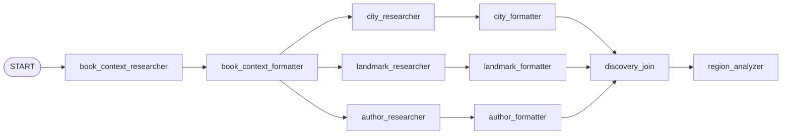

# My Storyland agent service

This repository is the agent service behind [My Storyland](https://mystoryland.ai). Give it a book, and it finds the places connected to the story, groups them into regions and plans stops for the chosen regions. Give it a place, and it returns books that happen there. It is a FastAPI server that streams progress and results as server-sent events (SSE). The pipeline is a set of Google ADK agents on Gemini (`gemini-3.1-flash-lite`), and the research agents can call Google Search. The website does not call this service directly: a gateway service does, with a shared secret.

**Measured on mystoryland.ai, 2026-11-22:** a first search for a book showed the journey about 17 seconds after submit. Repeating the same search took about 5 seconds, served from the cache. On that date the cache held only the discovery result, so the composition step ran on every request. Since [ADR #36](docs/ARCHITECTURE.md#36-the-readers-first-compose-is-cached-too-2026-11-23), the reader's first composition of a book (the first region, which is what the home page composes) is cached too; these timings were measured before that change. The service's own measurement of both waits, from Langfuse traces, is in [ADR #33](docs/ARCHITECTURE.md#33-the-two-reader-waits-have-numbers-a-langfuse-latency-report-2026-11-01) (`scripts/latency_report.py`).

![Diagram of one book search. The gateway service sends a discover request, then a compose request, to the SSE API (1). A cache hit returns regions with no model call (2). A miss runs the discovery graph (3), whose agents call Gemini, and its researchers can use Google Search (4). The research, and which researchers searched, go to session state (5). Compose runs trip_composer for the chosen regions (6). Claim checks compare literal and historical labels with that research (7). Regions, then the itinerary, stream back as SSE events (8).](docs/images/agent-service.png)

## Fail closed

The trip composer labels each stop with how it connects to the book: `literal` (the book names the place), `historical` (a documented link to the book or its author), `thematic`, or `vibe` (a similar mood). The label is the model's own claim, so the server checks it before the itinerary leaves ([`core/extraction.py`](core/extraction.py)). A `literal` or `historical` stop whose name is not found in the discovery research becomes `vibe`, and its cited source is removed. Research counts as evidence only when its researcher called Google Search (MYS-816). If none of the researchers that returned places searched, every `literal` and `historical` stop is downgraded. Stops are never dropped and never upgraded. Details: [Fail closed: unsearched researchers](#fail-closed-unsearched-researchers-cannot-ground-a-claim-mys-816) below and ADR #26 in [`docs/ARCHITECTURE.md`](docs/ARCHITECTURE.md).

## How quality is measured

The eval harness in [`evaluation/`](evaluation/README.md) runs the pipeline on fixed datasets:

| Flow | Dataset | What is scored |
|---|---|---|
| Book → trip | `storyland_eval`, `books_v1` (10 books each) | An LLM judge scores six dimensions from 1 to 5: book relevance, preferences, completeness, actionability, geography, engagement. The runner also records which researchers called Google Search. |
| Place → books | `place_to_book_v1` (16 places) | Pass or fail: a minimum number of `literal` books per place, an empty answer for invented places (Macondo, Wakanda), no book listed twice, the expected author for each named book. |
| Near me, suggestion chips, film and series claims | `local_atmosphere_v1` (8), `expansion_v1` (5), `screen_v1` (12) | Pass-or-fail checks; "near me" is also scored by the judge. |

Runs are on demand, not on a schedule, because each one spends Gemini quota. The place → books, near-me, chips and film runners end with `RELEASE: ALLOWED` or `RELEASE: BLOCKED`, and a change to the AI quotes that line before it ships; the book → trip runner has no release gate yet. Results by prompt version are in [`evaluation/PROMPT_CHANGELOG.md`](evaluation/PROMPT_CHANGELOG.md): the latest published run, prompt v5 on 2026-11-21, passed 16 of 16 place → books cases (v6 changed only the book-identity step and publishes no eval run). Runs made in GitHub Actions attach their results JSON to the run ([Evaluation (manual dispatch)](https://github.com/o-ostrovskiy/storyland-ai/actions/workflows/scheduled-eval.yml)). The judge's scores move by up to ±0.40 between identical runs, so they catch large regressions, not small ones.

## Quick Start

### Installation

```bash
# Clone and setup
git clone https://github.com/o-ostrovskiy/storyland-ai
cd storyland-ai
python3 -m venv .venv
source .venv/bin/activate
pip install -e ".[dev]"

# Configure API key
cp .env.example .env
# Edit .env and add your GOOGLE_API_KEY

# Optional: Configure Langfuse for LLM observability
# Add your Langfuse credentials to .env:
# - LANGFUSE_SECRET_KEY
# - LANGFUSE_PUBLIC_KEY
# - LANGFUSE_HOST
```

### Run

```bash
# Start the FastAPI SSE API server
make run-api
# curl http://localhost:8080/api/v1/health
```

**What you get:**
- Region options to choose from
- Cities to visit with suggested days
- Landmarks tied to the book's setting
- Author-related sites (birthplace, museums, etc.)
- Practical travel details and tips

See [Configuration](#configuration) for environment variables.

## Architecture

The service uses a two-phase workflow with region selection between the phases (diagram at the top; ADR #1). Book title and author arrive pre-confirmed from the gateway (ADR #12). The discovery graph, as wired in `agents/orchestrator.py`:



Composition is a single agent, `trip_composer` (`book_to_place_composition`), run on the regions the caller sends to `/compose`.

**Two-phase design:**
1. **Phase 1 (Discovery)**: Finds all locations and groups them into practical travel regions
2. **Human Selection**: User chooses which region(s) to explore (prevents impractical multi-continent itineraries)
3. **Phase 2 (Composition)**: Creates detailed itinerary for selected region(s) only

### Key Components

- **Book Context Agent** - Researches setting, themes, and time period
- **Discovery Agents** - Parallel search for cities, landmarks, and author sites
- **Region Analyzer** - Groups cities by geographic proximity using LLM world knowledge
- **Trip Composer** - Creates personalized itinerary based on user preferences
- **Reader preferences** - `user:preferences` from session state go straight into the composer prompt (`core/prompts.py`); the separate reader-profile agent was removed in MYS-436
- **Place→Book Resolver** - `core/place_to_book.py`: researcher → formatter that returns books that happen in a named place (ADR #20, #30)
- **Local Atmosphere Pipeline** - Single-phase researcher → formatter that finds nearby places (within ~80 km of the user) whose mood and aesthetic evoke the book, for readers who can't travel to the actual setting
- **Expansion Pipeline** - On-demand researcher → formatter that adds 3-5 new places to an existing city when the user clicks a suggestion chip
- **Book Recommendation Agent** - On-demand single agent that recommends 5 books based on the source book, destination cities, and themes (triggered by the "Find books like this" chip)

**Session State Keys:**

| Key | Phase | Description |
|-----|-------|-------------|
| `book_metadata` | 1 | Exact title and author (from request DTO) |
| `book_context` | 1 | Setting, themes, time period |
| `city_discovery` | 1 | Cities with literary connections |
| `landmark_discovery` | 1 | Specific landmarks and sites |
| `author_sites` | 1 | Author-related locations |
| `region_analysis` | 1 | Geographic region grouping |
| `user:preferences` | All | User travel preferences (persists across sessions) |
| `composer_envelope` | 2 | Composer output: itinerary + suggestion chips, checked before it is used |
| `final_itinerary` | 2 | Complete travel plan |
| `unverified_discovery` | 1 | Discovery payloads whose researcher never called Google Search; excluded from evidence (MYS-816) |
| `last_suggestions` | 2 | Current set of suggestion chips |
| `expansion_count` | Post-2 | Number of place-expansion requests made |
| `book_recommendation_chip_id` | 2 | ID of the server-stamped "Find books like this" chip |
| `book_recommendation_count` | Post-2 | Number of book recommendation requests made |
| `last_book_recommendations` | Post-2 | Most recent BookRecommendationsResult |
| `job_failed` | All | Terminal failure marker (set on error, cleared on compose retry) |

**Storage:** In-memory (default) or SQLite persistence. Multi-user support with isolated data. See [Configuration](#configuration) for options.

**Technology Stack:**
- [Google Agent Development Kit (ADK)](https://github.com/google/adk-python)
- Google Gemini models (see "Which model runs where" below)
- Pydantic for data validation
- SQLite for persistence

**Which model runs where:**

| Role | Model | Where it's set |
|------|-------|----------------|
| All agent workflows — discovery, composition, local-atmosphere, expansion, book recommendations, place→book | `gemini-3.1-flash-lite` (default) | `MODEL_NAME` env var; code default `DEFAULT_MODEL_NAME` in `common/config.py`. One shared model — every workflow runs on the executor's single `Gemini` instance. |
| Eval system-under-test (CI eval runs) | `gemini-3.1-flash-lite` | `.github/workflows/scheduled-eval.yml` `.env` step; the runners stamp the effective value as `model_under_test` in run metadata and results JSON. |
| Eval LLM-as-judge | `_DEFAULT_JUDGE_MODEL` in `evaluation/tools/llm_scorer.py` (pinned, currently `gemini-3.1-pro-preview`) | Read the constant, never this table — it was `gemini-2.5-flash-lite` until 2026-08-09, when the whole 2.5 line began 404ing (MYS-825). Intentionally decoupled from `MODEL_NAME`: a fixed judge keeps scores comparable across system-model lifts, and it is deliberately a *different family* from the generator so the model does not grade its own work. |

> Production note: the deployed box reads `MODEL_NAME` from its own `.env.prod`, which deploys never overwrite — the value there can drift from the repo default (see ADR #23 outcome note in `docs/ARCHITECTURE.md`).

### API (FastAPI SSE)

The service includes a FastAPI server with Server-Sent Events streaming for web/mobile clients. The API offers a two-phase travel-planning flow plus a single-phase **local-atmosphere** mode for users who can't travel:

```bash
# Start the API server
make run-api   # http://localhost:8080

# Health check (always open — no secret required)
curl http://localhost:8080/api/v1/health

# Discover locations (phase 1) — streams progress events, returns regions
# Add -H "X-Internal-Secret: <value>" if INTERNAL_API_SECRET is set in .env
curl -N -X POST http://localhost:8080/api/v1/itinerary/discover \
  -H "Content-Type: application/json" \
  -d '{"book_title": "1984", "author": "George Orwell"}'

# Compose itinerary (phase 2) — streams final itinerary
curl -N -X POST http://localhost:8080/api/v1/itinerary/{job_id}/compose \
  -H "Content-Type: application/json" \
  -d '{"region_ids": [1]}'

# Local atmosphere (single-phase) — places near the user that match the book's mood
curl -N -X POST http://localhost:8080/api/v1/itinerary/local-atmosphere \
  -H "Content-Type: application/json" \
  -d '{
        "book_title": "Wuthering Heights",
        "author": "Emily Brontë",
        "user_location": {"label": "New York, NY", "lat": 40.7128, "lng": -74.0060},
        "radius_km": 80
      }'

# Check job status
curl http://localhost:8080/api/v1/itinerary/{job_id}/status
```

SSE event types: `progress`, `metadata`, `regions`, `itinerary`, `expansion`, `book_recommendations`, `error`, `done`. The local-atmosphere endpoint emits `progress → metadata → itinerary → done` (no `regions` event). The `/expand` endpoint emits `progress → expansion → done`. The `/recommend-books` endpoint emits `progress → book_recommendations → done`.

**Job status states** (`GET /api/v1/itinerary/{job_id}/status`):

| Status | Meaning |
|--------|---------|
| `searching` | Phase 1 (Discovery) in progress |
| `discovering` | Discovery running, collecting locations |
| `regions_ready` | Discovery complete, awaiting region selection |
| `composing` | Phase 2 (Composition) in progress |
| `completed` | Itinerary ready |
| `failed` | Terminal error — book not found, timeout, or cancellation (takes priority over all other states) |

Failed jobs can be retried by calling `/compose` again with the same `job_id`; the failure marker is cleared automatically when a new compose attempt begins.

### AI Models

All agents share one Gemini model (default `gemini-3.1-flash-lite`, see the table above). Agent outputs are validated against the Pydantic models in `models/` and `api/models.py`. For measured speed, see the numbers at the top of this README and ADR #33 in `docs/ARCHITECTURE.md`.

### Search-grounding observability

Researcher agents ground their answers with Gemini's built-in `google_search`.
Whether a given call *actually* searched is not something the prompt can
guarantee, so it is logged. Four events, all INFO:

| Event | Where | Meaning |
|-------|-------|---------|
| `search_grounding_captured` | every model response | The call ran `google_search`. Carries `query_count`, `source_count`, `source_hosts`. |
| `search_grounding_absent` | every model response | No grounding metadata came back. **Expected for every formatter** (they are tool-less by design — ADK forbids `tools` + `output_schema` on one agent); notable for anything named `*_researcher`. |
| `discovery_grounding_audit` | end of a fresh `discover()` | How many entries in each discovery payload trace back to the researchers' text: `kind`, `grounded`, `total`. |
| `discovery_grounding_no_capture` | end of a fresh `discover()` | No researcher text or no entries — "cannot say", never "nothing was grounded". |
| `discovery_unverified_payloads` | fresh `discover()`, when a researcher skipped | Names the researchers that never searched and the payloads struck from the grounding evidence. |

Read them together: `search_grounding_absent agent=city_researcher` means that
researcher answered from model memory.

### Reader waits (latency report)

`python scripts/latency_report.py [--days 7] [--env production]` prints p50/p95 per
UTC day, with the sample size, for the two waits a reader feels: discover → first
region (`book_to_place_discovery_invocation`) and compose → done
(`book_to_place_composition_invocation`), plus the whole window pooled. Read-only
(`GET /v2/metrics` with the `LANGFUSE_*` keys from `.env` or the shell, the shell
winning; no Gemini). Fewer than 20 runs → "too few"; no runs → "no data"; an API
error or a malformed answer (a row with runs but no day in the window included)
exits 2 with `latency unverified`. Targets and baseline: `docs/ARCHITECTURE.md` #33.

**Measured rate (2026-08-10, `gemini-3.1-flash-lite`):** roughly one to two of
the four researchers skip on most runs, on realist and fictional books alike.
Which one varies run to run — all four have been observed skipping, and a
skipped researcher still emits places (one run produced the author site
"Personal Office"). It is stochastic, not a broken prompt clause.

### Fail closed: unsearched researchers cannot ground a claim (MYS-816)

`discover()` records which researchers searched and writes the payloads of
those that did not to `unverified_discovery` in session state.
`SessionStateAccessor.grounding_research_text` then omits them, so at compose
time the existing `downgrade_ungrounded_match_types` guard cannot find those
names as evidence and demotes any stop resting on them to `match_type="vibe"`
with `grounding_source` cleared.

No new enforcement was added — the haystack was narrowed and the existing
guard did the rest. Notes that matter when changing this:

- The composer still **receives** unverified payloads; they are often correct
  and dropping them would thin results. They just cannot back a
  `literal`/`historical` claim.
- The flag rides in the discovery **cache bundle** (`discover:v3:`). A hit that
  dropped it would serve unprotected results on the most-requested titles.
- An agent that never *ran* is not "unsearched" — fail open on missing
  evidence, the same rule every grounding guard here follows.
- The `discovery_grounding_audit` numbers are provenance-aware for the same
  reason: unioning all four researchers' text let a searching researcher
  vouch for a non-searching one, which is why this read as 100% grounded
  when it was first measured.

Query strings are deliberately never logged — they embed the user's book
title, and `common/logging.py` forwards INFO logs to Sentry against an
allowlist that excludes user content. Full source URIs go to Langfuse
generation metadata instead. Note those URIs are `vertexaisearch.cloud.google.com`
redirects, not publisher domains.

**Gemini reports a search on one of two channels**, and `extract_search_metadata`
reads both — checking only the first reports a searching agent as unsearched:

| Request shape | Channel | Sources? |
|---------------|---------|----------|
| built-in `google_search` alone | `grounding_metadata.web_search_queries` | yes, `grounding_chunks[].web` |
| plus `tool_config.include_server_side_tool_invocations` | `tool_call` parts on the response content; `grounding_metadata` is `None` | no — `tool_response` carries only Google's suggestion-chip markup |

The second shape is not optional where it applies: the API rejects a built-in
tool alongside any function declaration without that flag (400
`INVALID_ARGUMENT`), and ADK injects a `set_model_response` declaration into
every agent carrying both `tools` and `output_schema`. A queries-only receipt
from that channel is fully grounded, not degraded.

## Configuration

All configuration is via environment variables in `.env`. Copy `.env.example` to get started.

| Variable | Description | Default |
|----------|-------------|---------|
| `GOOGLE_API_KEY` | **Required.** Google AI API key from [AI Studio](https://aistudio.google.com/app/apikey) | — |
| `MODEL_NAME` | Gemini model to use | `gemini-3.1-flash-lite` (code default — a deploy without MODEL_NAME no longer crashes at boot) |
| `USE_DATABASE` | Enable SQLite persistence | `false` |
| `DATABASE_URL` | SQLite database path | `sqlite+aiosqlite:///storyland_sessions_v2.db` |
| `SESSION_MAX_EVENTS` | Max events in session | `20` |
| `MAX_CONTEXT_TOKENS` | Max tokens for context window | `30000` |
| `WORKFLOW_TIMEOUT` | Max seconds for entire workflow | `300` |
| `AGENT_TIMEOUT` | Max seconds per agent | `60` |
| `LOG_LEVEL` | Logging level (DEBUG/INFO/WARNING/ERROR) | `INFO` |
| `ENABLE_ADK_DEBUG` | Enable ADK internal debug logging | `false` |
| `LANGFUSE_SECRET_KEY` | Langfuse secret key (optional) | — |
| `LANGFUSE_PUBLIC_KEY` | Langfuse public key (optional) | — |
| `LANGFUSE_HOST` | Langfuse host URL (optional) | — |
| `SENTRY_DSN` | Sentry error-tracking DSN (optional) — unset means Sentry is fully disabled (local/CI). Errors only by default; performance tracing stays off since agent runs are already traced in Langfuse. | — |
| `SENTRY_ENABLE_LOGS` | Ship INFO+ logs to Sentry Logs (searchable/alertable). Kill switch — only takes effect when `SENTRY_DSN` is set. structlog error/critical become Sentry events, info/warning become Sentry logs, debug stays local (LLM prompts can appear there). | `true` |
| `SENTRY_ENABLE_METRICS` | Emit Sentry metrics. Every non-debug structlog event is auto-counted as `log.events` `{event, level}`, making timeouts/cache-hits/failures chartable; new call sites can use `sentry_sdk.metrics` directly (examples in `api/sentry.py`). | `true` |
| `SENTRY_TRACES_SAMPLE_RATE` | Sentry performance-tracing sample rate (0.0–1.0) | `0.0` |
| `CORS_ORIGINS` | Allowed CORS origins for API (comma-separated) | `*` |
| `INTERNAL_API_SECRET` | Shared secret with the gateway service — when set, all itinerary endpoints require an `X-Internal-Secret` header with this value. The health endpoint (`/health`) is always open. Leaving it empty (standalone/dev use) also requires `REQUIRE_GATEWAY_SECRET=false`, otherwise the service refuses to start. | — |
| `REQUIRE_GATEWAY_SECRET` | Fail-closed switch for gateway auth: when `true`, an empty `INTERNAL_API_SECRET` is a fatal boot error instead of an open service that trusts the forgeable `X-User-ID` header. Set `false` explicitly for standalone/dev use without a gateway (`.env.example` ships this opt-out). | `true` |

Free tier includes 15 RPM and 200 requests/day — sufficient for development.

## Development

### Project Structure

```
storyland-ai/
├── models/              # Pydantic data models
│   ├── book.py          # BookMetadata, BookContext, BookInfo
│   ├── discovery.py     # CityDiscovery, LandmarkDiscovery, AuthorSites,
│   │                    # RegionCity, RegionOption, RegionAnalysis
│   ├── itinerary.py     # TripItinerary, CityPlan, CityStop
│   ├── place_to_book.py # PlaceBookCandidate/PlaceToBookCandidates/Result (reverse discovery)
│   └── preferences.py   # TravelPreferences
│
│
├── agents/              # AI agent definitions
│   ├── book_context_agent.py     # Book setting research
│   ├── discovery_agents.py       # City/landmark/author discovery
│   ├── trip_composer_agent.py    # Itinerary composition
│   ├── local_atmosphere_agent.py    # Researcher+formatter for "near me" mode
│   ├── expansion_agent.py           # Researcher+formatter for place expansion chips
│   ├── book_recommendation_agent.py # Researcher+formatter for "Find books like this" chip
│   ├── place_to_book_agent.py        # Researcher+formatter for place→book reverse discovery
│   ├── region_analyzer_agent.py     # Geographic region grouping
│   ├── orchestrator.py              # Two-phase + local-atmosphere + expansion + book-rec + place→book workflows
│   ├── prompts.py                   # AgentPrompts dataclass + versioned loader
│   └── prompts/                  # Versioned prompt sets
│       ├── v1.json               # Original prompts (git ref 4c6fdc9)
│       ├── v2.json               # Prompts as of PR #63 (history)
│       ├── v3.json               # + region geo identity fields (MYS-460)
│       ├── v4.json               # + place→book revision (ai-private#71)
│       ├── v5.json               # + place→book small-town revision (Luga)
│       └── v6.json               # Current prompts (CURRENT_PROMPT_VERSION): + book-identity check
│
├── core/                # Transport-agnostic orchestration & SDK
│   ├── executor.py      # WorkflowExecutor (discover/compose/expand/recommend)
│   ├── run_harness.py   # Shared ADK runner scaffold (event pump, timeout/error policy)
│   ├── place_to_book.py # PlaceToBookResolver (place→book reverse routing)
│   ├── cache.py         # TTL/LRU result cache + builders (discovery, compose, place→book stores)
│   └── session_state.py # Typed session-state accessor
│
├── api/                 # FastAPI SSE streaming API
│   ├── app.py           # Application factory with lifespan
│   ├── routes.py        # HTTP endpoints (discover, compose, expand, recommend-books, local-atmosphere, place-to-book, status, health)
│   ├── streaming.py     # SSE async generators wrapping ADK Runner
│   ├── models.py        # Request/response/SSE event Pydantic models
│   └── dependencies.py  # Shared app state & dependency injection
│
├── services/            # Core services
│   └── session_service.py   # Session management (InMemory/SQLite)
│
├── common/              # Shared utilities
│   ├── config.py        # Configuration management
│   ├── logging.py       # Structured logging (structlog)
│   └── search_grounding.py  # Search receipts (queries/sources) off a model response
│
├── plugins/             # ADK runner plugins
│   └── langfuse_plugin.py  # Langfuse observability & token tracking
│
├── scripts/             # Read-only operator scripts
│   └── latency_report.py   # Reader waits (first region, full journey) p50/p95 per day from Langfuse
│
├── tests/               # Test suite
│   ├── unit/            # Unit tests (no API calls)
│   └── integration/     # Integration tests (VCR cassettes)
│
├── pyproject.toml       # Dependencies & pytest config
└── .env.example         # Environment template
```

### Extending the Codebase

**Adding a new agent** — create in `agents/`, import in `orchestrator.py`:
```python
from google.adk.agents import LlmAgent
def create_my_agent(model):
    return LlmAgent(name="my_agent", model=model, instruction="...")
```

**Adding a new model** — create in `models/`:
```python
from pydantic import BaseModel, Field
class MyModel(BaseModel):
    field1: str = Field(description="Description")
```

### Prompt Engineering

Agent prompts include reliability improvements:

- **Anti-hallucination:** `"If the research found no cities, return an empty list - do not hallucinate."`
- **Error handling:** `"If the tool returns an error, report it clearly and explain what went wrong"`
- **Disambiguation:** Book title and author injected into search queries to avoid confusion with similarly-named books

**Versioned prompts** — all agent instructions live in `agents/prompts/v6.json` (`v1.json`–`v5.json` kept for history). To add a new prompt version, create the next `agents/prompts/vN.json` and pass `--prompt-version vN` to the eval runner. The current version (`v6`) is controlled by `CURRENT_PROMPT_VERSION` in `agents/prompts.py`. Prompt change history is in [`evaluation/PROMPT_CHANGELOG.md`](evaluation/PROMPT_CHANGELOG.md). Git is the only source of prompts; a read-only mirror is pushed to Langfuse for the playground (`make prompts-sync`, auto on merge to `main` — see [evaluation/README.md](evaluation/README.md#prompt-versioning)).

## Deployment

Production runs on a single self-hosted Lightsail box via docker compose (see
`storyland-infrastructure/deploy/`). Releases go through the **G5-gated
`Deploy AI (prod)`** GitHub Action (`.github/workflows/deploy-ai-prod.yml`):

- It is `workflow_dispatch`-only, so it never fires automatically.
- The run pauses on the `production` GitHub Environment for the required
  reviewer's (Olga's) approval — that pause **is** the G5 gate.
- After approval it calls the reusable SSH-deploy workflow in
  `storyland-infrastructure` (`deploy-service.yml`, `service: storyland-ai`),
  which rsyncs the source to the box and rebuilds/restarts the `storyland-ai`
  service.

On-box runtime config (`.env.prod`: `GOOGLE_API_KEY`, `INTERNAL_API_SECRET`,
`LANGFUSE_*`, `CACHE_TTL_SECONDS`, `CACHE_MAX_ENTRIES`) is the source of truth and
is excluded from the rsync, so a rebuild never clobbers it. The release action is
post-merge only and never triggers an eval (eval = real Gemini spend). Manual
fallback: `KEY=~/.ssh/storyland.pem storyland-infrastructure/deploy/deploy.sh storyland-ai`.

One-time setup (out-of-band, not in the repo): add the `LIGHTSAIL_SSH_KEY` and
`BOX_IP` repo secrets and create a `production` Environment with a required
reviewer.

## Testing

```bash
make test                  # Unit tests (1,500+; exact count changes per PR)
make test-integration      # Integration tests with VCR cassettes (excludes real_api)
make test-integration-live # Live tests that hit real APIs (real_api marker; uses quota)
make test-all              # Both
make test-cov              # With coverage
```

Tests never reach Langfuse by default, even with real keys in `.env`: `tests/conftest.py` blanks them and turns tracing off. `make test-integration-live` and `make test-integration-vcr-record` opt back in with `STORYLAND_TEST_LANGFUSE_EXPORT=1`; a run that includes `tests/unit/` refuses that flag.

The unit suite (`tests/unit/`) by area — per-module counts rot with every PR, so they are not tracked here:

| Area | Modules |
|------|---------|
| Models & agents | `test_models.py`, `test_agents.py` |
| Core workflow | `test_core.py`, `test_discovery_errors.py`, `test_empty_discovery_guard.py`, `test_book_identity.py`, `test_retry_backoff.py` |
| API layer | `test_api.py`, `test_gateway_auth.py`, `test_ratelimit.py`, `test_request_input_limits.py`, `test_dependencies.py` |
| Caching | `test_cache.py`, `test_disk_cache.py`, `test_cache_version.py`, `test_compose_cache.py` |
| Place features | `test_place_key.py`, `test_place_to_book.py`, `test_place_to_book_eval.py` |
| Quality & guardrails | `test_llm_scorer.py`, `test_tone_guardrail.py`, `test_recommendation_floor.py`, `test_judge_calibration.py`, `test_spot_check.py` |
| Eval harnesses | `test_local_atmosphere_eval.py`, `test_expansion_eval.py`, `test_eval_dataset_routing.py` |
| Observability | `test_sentry.py`, `test_langfuse_plugin_concurrency.py`, `test_langfuse_export_guard.py`, `test_langfuse_pricing.py`, `test_langfuse_unpriced_model.py`, `test_search_grounding.py`, `test_langfuse_search_grounding.py`, `test_discovery_grounding_audit.py`, `test_unverified_discovery_downgrade.py`, `test_latency_report.py` |
| Sessions & ops | `test_services.py`, `test_session_retention.py` |

Integration tests use [VCR.py](https://vcrpy.readthedocs.io/) to record/replay HTTP interactions. For quality evaluation, see [evaluation/README.md](evaluation/README.md).

### Live cache verification (`real_api`)

`tests/integration/test_cache_real_api.py` is the live counterpart to the mocked
cache-hit unit test. The Discovery result cache is always on, so it calls
`discover()` twice with an identical book/author and meters
`Gemini.generate_content_async`
directly (call count + summed `usage_metadata.total_token_count`) to prove the
**second call is a cache hit that makes zero new Gemini calls and consumes zero
new Gemini tokens** while returning the same regions. It is marked `real_api`, so
it is excluded from the default `make test-integration` run and only fires via
`make test-integration-live`. It hits the live API (no VCR — recorded responses
would defeat token counting), so it needs `GOOGLE_API_KEY` and uses a small
amount of quota; it skips when the key is absent.

## Troubleshooting

- **Rate limits (429):** Retry logic handles automatically. Wait ~60s between books.
- **API key issues:** `python -c "import os; from dotenv import load_dotenv; load_dotenv(); print('OK' if os.getenv('GOOGLE_API_KEY') else 'MISSING')"`
- **Database issues:** `rm storyland_sessions_v2.db` to start fresh
- **Virtual env not activated:** `source .venv/bin/activate`
- **Missing dependencies:** `pip install -e ".[dev]"`
- **Timeout errors:** Increase `WORKFLOW_TIMEOUT` in `.env` (default: 300s)

## Database Reference

When `USE_DATABASE=true`, ADK's `DatabaseSessionService` creates a `sessions` table. On the ADK 2.x line the default DB file is `storyland_sessions_v2.db` (fresh at the 2.x cutover — the 1.x schema is incompatible), and a fresh database is created on the "v1" internal schema, which adds an `adk_internal_metadata` bookkeeping table alongside the four data tables. The `sessions` table columns are unchanged:

```sql
CREATE TABLE sessions (
    app_name VARCHAR(128) NOT NULL,
    user_id VARCHAR(128) NOT NULL,
    id VARCHAR(128) NOT NULL,          -- note: "id", not "session_id"
    state TEXT NOT NULL,               -- JSON-encoded session state
    create_time DATETIME NOT NULL,     -- note: "create_time", not "created_at"
    update_time DATETIME NOT NULL,
    PRIMARY KEY (app_name, user_id, id)
)
```

**State scopes:** No prefix = session-scoped (ephemeral). `user:` prefix = persists across sessions. `app:` prefix = global.

**Common queries:**
```sql
-- User's book history
SELECT id, json_extract(state, '$.book_title') as book, create_time
FROM sessions WHERE app_name = 'storyland' AND user_id = 'alice'
ORDER BY create_time DESC;

-- User preferences (keys with colons must be quoted)
SELECT json_extract(state, '$."user:preferences"') as preferences
FROM sessions WHERE app_name = 'storyland' AND user_id = 'alice'
ORDER BY create_time DESC LIMIT 1;
```

**Maintenance:**
```bash
rm storyland_sessions_v2.db                    # Start fresh
sqlite3 storyland_sessions_v2.db "VACUUM;"     # Reclaim space
cp storyland_sessions_v2.db backup_$(date +%Y%m%d).db  # Backup
```

## Documentation

- **[Architecture Decisions](docs/ARCHITECTURE.md)** - ADRs explaining key design choices
- **[Evaluation & Observability](evaluation/README.md)** - Quality evaluation pipeline and Langfuse token/cost tracking

---

*Built with Google Agent Development Kit*
